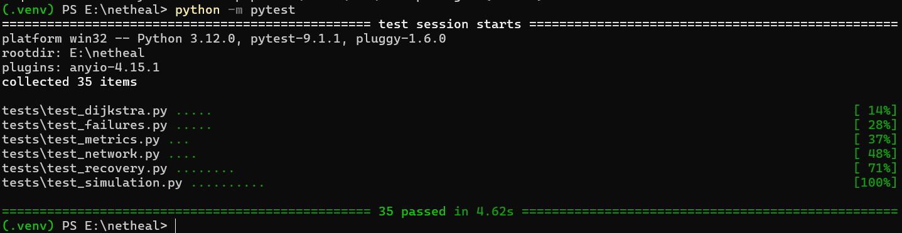
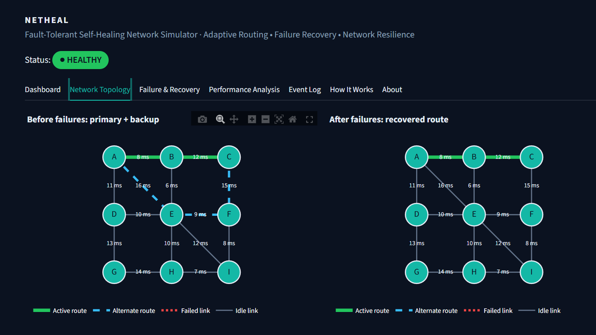
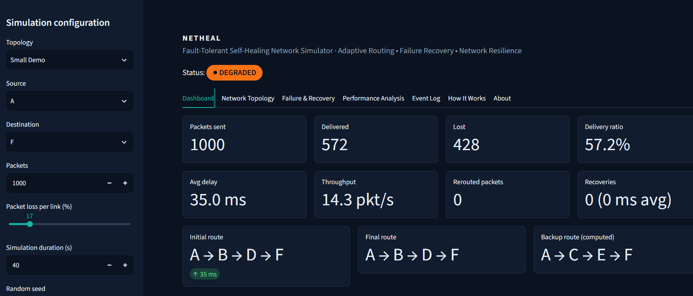
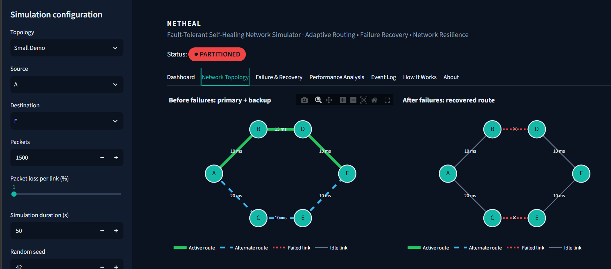

# NetHeal

**Fault-Tolerant Self-Healing Network Simulator with Adaptive Routing and Automatic Route Recovery**

A discrete-event network simulator (SimPy) that models packet transmission, link/node failures, Dijkstra-based
adaptive routing, alternate-path recovery, packet loss, latency and throughput, with an interactive
Streamlit/Plotly dashboard. *It is a simulation, not a real network controller.*

## Problem Statement
Networks fail: links are cut and routers crash. A network that keeps using a dead route silently loses traffic.
How much does automatic route recovery actually help, and how fast does it act?

## Motivation
Fault tolerance and adaptive routing are core Computer Networks topics. NetHeal makes them *measurable*:
the same experiment is run with and without recovery, so the benefit is computed rather than asserted.

## Objectives
1. Model a weighted topology with latency, bandwidth, loss and up/down state.
2. Implement Dijkstra ourselves (not `networkx.shortest_path`).
3. Inject link/node failures on the simulation clock and detect broken routes.
4. Recompute routes and reroute packets; measure delivery, loss, delay, throughput, recovery time.
5. Present everything in a clear dashboard and export CSVs for the lab report.

## Key Features
- Three topologies (Small Demo, Medium, Mesh) and six predefined scenarios.
- Own Dijkstra, computed primary and backup (alternate) routes.
- Scheduled link/node failures, optional restoration, multiple simultaneous failures.
- Packet rerouting from the current node; graceful handling of partitioned networks.
- Before/after comparison (without vs with self-healing) from real simulation runs.
- Seeded randomness: same seed + configuration gives identical results.
- Event log with SimPy-clock timestamps, CSV export, packet inspector.

## Architecture
```
Streamlit UI (visualization/dashboard.py, app.py)
      |
Experiment runner (core/experiment.py)
      |
Simulation (core/simulation.py, SimPy) --- Metrics (core/metrics.py)
      |                         \--- Event log (core/events.py)
Routing (routing/): dijkstra, route_manager, failure_manager
      |
Network model (core/network.py, node.py, link.py, packet.py) on NetworkX
```
The GUI never contains routing logic; the engine runs without Streamlit. See `docs/architecture.md`.

## Technology Stack
Python 3.11+, SimPy, NetworkX (graph storage), Streamlit, Plotly, Pandas, NumPy, pytest.

## Network Model
Nodes are routers (up/down). Links are bidirectional with `latency_ms` (also the routing cost),
`bandwidth_mbps` (informational), `loss_probability` and up/down state. Packet delay is propagation only
(no queueing). Loss is drawn per link traversal from a seeded `random.Random`.

## Routing Algorithm
`routing/dijkstra.py`: heap-based Dijkstra over *usable* neighbours only (link up and both end nodes up).
Complexity O((V+E) log V). Details in `docs/algorithms.md`.

## Primary and Alternate Routes
Primary = Dijkstra on the live topology. Backup = Dijkstra after removing all primary links on a copy
(link-disjoint); if none exists, the cheapest route avoiding any single primary link. It is computed, never
hard-coded, and is "a backup route", not guaranteed second-best.

## Failure Injection
Failures are **scheduled events** (`FailureSpec(time, kind, target, restore_time)`). Streamlit reruns the script on
every click, so live mid-run clicking is not possible; instead you schedule failures, run, and the dashboard replays
the results. Link, node and multiple failures are supported.

## Recovery Mechanism
```
failure -> route invalidated -> detection delay (20 ms) -> Dijkstra -> compute delay (5 ms) -> new route installed
```
Recovery time = failure time -> new route installed (25 ms by default; both delays are *model parameters*).
Packets hitting the dead component before reconvergence are dropped; afterwards in-flight packets are rerouted
from where they are. **Without recovery** the original route is never recomputed; **with recovery** it is.

## Packet Simulation
SimPy processes: packet generator, one transmit process per packet, one process per scheduled failure, one per
recovery. Timestamps come from `env.now`.

## Metrics
Sent, delivered, dropped, delivery ratio (delivered/sent), loss rate (dropped/sent), average end-to-end delay,
throughput (delivered / duration, packets/s), average hops, rerouted packets, recovery count, average recovery time.

## Experimental Scenarios
Example results (1000 packets, 20 s, seed 42, 1% loss per link except scenario 4), produced by this code:

| Scenario | Delivery without | Delivery with | Delay without (ms) | Delay with (ms) | Recoveries | Recovery (ms) | Final route |
|---|---|---|---|---|---|---|---|
| 1. Normal network | 96.7% | 96.7% | 35.0 | 35.0 | 0 | 0 | A>B>D>F |
| 2. Single link failure | 48.3% | 96.5% | 35.0 | 37.5 | 1 | 25 | A>C>E>F |
| 3. Node failure | 48.3% | 96.5% | 35.0 | 37.5 | 1 | 25 | A>C>E>F |
| 4. High packet loss (10%) | 73.8% | 73.8% | 35.0 | 35.0 | 0 | 0 | A>B>D>F |
| 5. Multiple failures (Mesh) | 33.8% | 96.8% | 26.0 | 28.8 | 2 | 25 | A>E>F>I |
| 6. No alternate path | 33.7% | 67.8% | 35.0 | 37.5 | 1 | 25 | none (partitioned) |

## Installation
```bash
git clone https://github.com/Matheswaran-S/netheal.git netheal && cd netheal
python -m venv .venv
source .venv/bin/activate        # Windows: .venv\Scripts\activate
pip install -r requirements.txt
```

## Running
```bash
streamlit run app.py
```
Programmatic use (no GUI):
```python
from scenarios.experiments import SCENARIOS
from scenarios.default_topologies import get_topology
from core.experiment import run_comparison
s = SCENARIOS["2. Single link failure"]
result = run_comparison(get_topology(s.topology).build(), s.to_config())
print(result.with_recovery.metrics)
```

## Testing
```bash
pytest
```
35 tests cover Dijkstra, failures, recovery, simulation behaviour, reproducibility and metrics.

## Project Structure
```
app.py            core/ (network, link, node, packet, simulation, metrics, events, experiment)
routing/          (dijkstra, route_manager, failure_manager)
scenarios/        (default_topologies, experiments)
visualization/    (topology, charts, dashboard, theme)
utils/helpers.py  tests/  docs/  exports/
```

## Screenshots
   
   35 Test cases passed
   
   
   

## Limitations
- Simulation only; no queueing, congestion, TCP or real packet capture.
- Failure detection/compute times are configured, not emergent.
- Failures must be scheduled before a run (no live mid-run clicking).
- Loss draws are shared across hops, so "without" and "with" runs see different random loss patterns after a failure.

## Future Enhancements
Queueing and bandwidth contention, link-state flooding (OSPF-style), custom topology editor, packet-flow animation.

## Team Contributions
- **Matheswaran S – Simulation:** `core/` (simulation, packet, link, node, metrics, events).
- **Nirmal Shah – Routing & Recovery:** `routing/`, `scenarios/`.
- **Madhav Subash K – GUI & Analytics:** `app.py`, `visualization/`, `utils/helpers.py` (CSV export).
